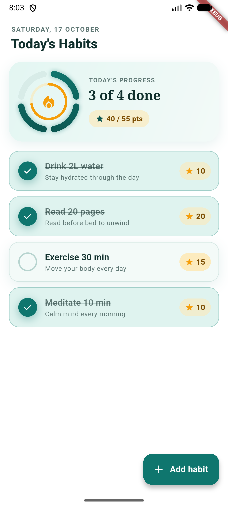
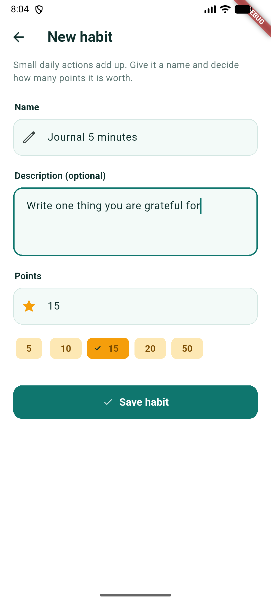
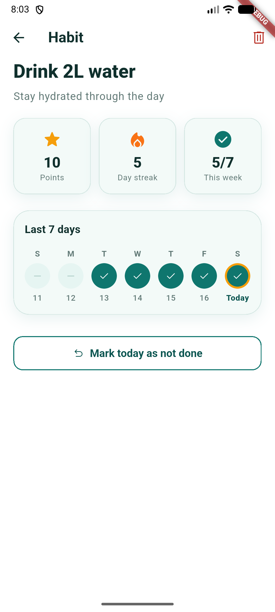

# Daily Habit Tracker

A Flutter app to create habits worth points, tick them off each day, and follow a 7-day streak per habit. Built with clean architecture on **Firebase Cloud Firestore** (no mock data).

| Today | Add habit | Habit detail |
|---|---|---|
|  |  |  |

Demo video: [docs/submission/demo.mp4](docs/submission/demo.mp4)

## Features

- **Today**: list of habits with a tappable done toggle, points per habit, and a progress header (segmented ring = habits done, inner ring = points earned). Swipe a habit left to delete it. Pull to refresh.
- **Add habit**: name, description and point value (quick-pick chips), with validation.
- **Habit detail**: name, description, points, current streak, a 7-day strip, mark today done/undone, delete.

## Architecture

```
Page -> Cubit -> UseCase -> HabitRepository (interface) -> HabitRepositoryImpl -> Firestore data source
```

| Layer | Contents | Rules |
|---|---|---|
| `domain/` | freezed entities, repository interface, use cases returning `Either<Failure, T>` (fpdart) | No Flutter / Firebase imports. Business rules live here: validation, points totals, 7-day window, streak. |
| `data/` | `HabitModel` + `toEntity()`, `FirestoreHabitDataSource`, `HabitRepositoryImpl` | The data source throws; the repository catches everything and returns `Left(Failure)`. It never throws. |
| `presentation/` | Cubits + freezed sealed states, pages, widgets | Cubits depend only on use cases. UI reacts through `BlocBuilder` / `BlocConsumer`. |
| `core/` | get_it DI, go_router routes, theme, `Failure`, `UseCase` | |

Firestore layout: `habits/{id}` (name, description, points, createdAt) and `completions/{habitId}_{yyyy-MM-dd}` (habitId, dateKey). Fetching a habit's week is seven document reads, so no composite index is needed.

Packages: `flutter_bloc`, `freezed`, `fpdart`, `get_it`, `go_router`, `cloud_firestore` (+ `firebase_core`, `intl`, `shimmer`, `material_symbols_icons`).

## Run it

1. Create a Firebase project with Firestore enabled, then run `flutterfire configure` (this repo already contains the config for the demo project).
2. Demo security rules (open, no auth in this app): see `firestore.rules`.
3. ```bash
   flutter pub get
   dart run build_runner build   # generated *.freezed.dart files are committed, so this is optional
   flutter run
   ```
4. Tests: `flutter test` (use cases: totals, streak, validation, delete).

## Notes

- The app has no authentication, so all habits live in one shared Firestore collection. Per-user data would add a `users/{uid}` prefix and rules.
- "Today" is the device's local date.
